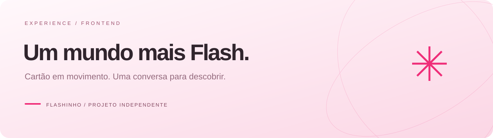
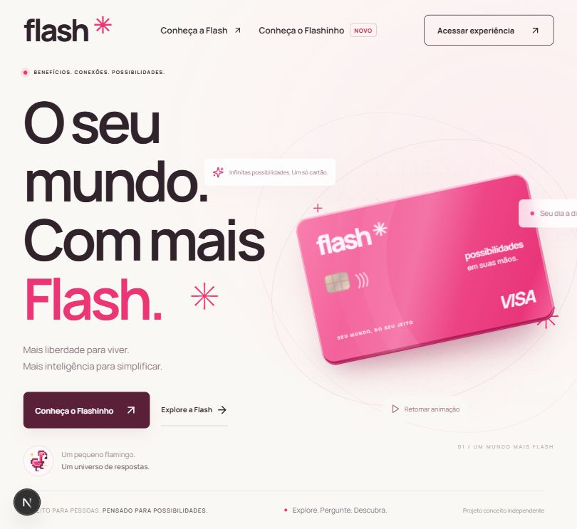
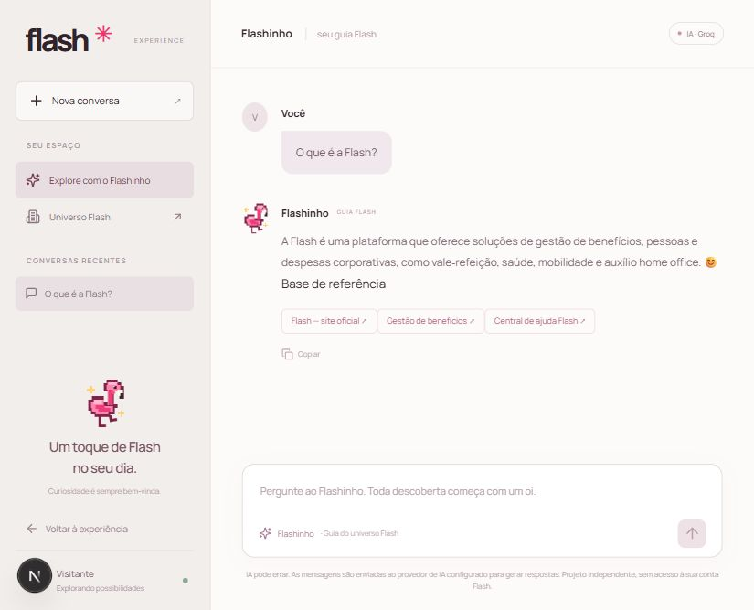
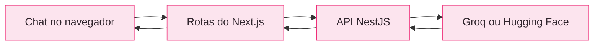

<div align="center">



# Flash Experience

Uma landing animada e um pequeno flamingo para conversar sobre a Flash.


[As telas](#as-telas) · [Rodar localmente](#rodar-localmente) · [Como funciona](#como-funciona) · [Backend](https://github.com/pedroigor-dev/flashbackend)

</div>

## A ideia

O projeto começa com um cartão rosa girando na tela e termina em uma conversa. Entre os dois, o Flashinho, um flamingo em pixel art, apresenta o universo de benefícios da Flash.

A proposta foi explorar animação, identidade visual e integração com IA numa experiência pequena, que dá para abrir, entender e testar. É um projeto independente de apresentação, sem vínculo oficial com a Flash.

## As telas

### O cartão é o centro da experiência



O cartão foi construído em CSS 3D, com frente e verso. O giro desacelera até revelar a frente, enquanto pequenas mensagens seguem as órbitas ao redor. O botão de pausa permite interromper o movimento.

A entrada tem nuvens em WebGL e o Flashinho em pixel art. Ao abrir o chat, o nome Flash cresce e revela a página através das letras.

### Uma conversa com o Flashinho



O chat oferece perguntas iniciais, histórico no navegador, cópia de respostas e exclusão de conversas. As respostas vêm do backend, que envia o contexto ao provedor de IA configurado. Se a chamada falhar, a interface mostra o erro e permite tentar novamente.

As capturas mostram a aplicação local. O repositório contém o código; ainda não há uma demonstração hospedada.

## Rodar localmente

Use **Node.js 22 ou superior** para executar frontend e backend com a mesma versão.

```bash
git clone https://github.com/pedroigor-dev/flashproject.git
cd flashproject
npm ci
npm run dev -- --port 3200
```

Abra [localhost:3200](http://localhost:3200). A landing funciona sem o backend; para receber respostas no chat, siga a configuração do [Flashinho API](https://github.com/pedroigor-dev/flashbackend#rodar-localmente) e inicie-o na porta `4000`.

O servidor Next.js usa `http://127.0.0.1:4000` como endereço padrão da API. Para mudar, crie um `.env.local` na raiz:

```dotenv
FLASH_BACKEND_URL=http://127.0.0.1:4000
```

Essa variável pertence ao servidor. As chaves da Groq e da Hugging Face ficam somente no `.env` do backend.

| Comando                        | O que faz                            |
| ------------------------------ | ------------------------------------ |
| `npm run dev -- --port 3200`   | Inicia o ambiente de desenvolvimento |
| `npm run typecheck`            | Verifica os tipos com TypeScript     |
| `npm run build`                | Gera o build de produção             |
| `npm run start -- --port 3200` | Executa o build gerado               |

## Como funciona



O navegador chama `/api/chat` no próprio Next.js. Essa rota encaminha a solicitação ao NestJS, que valida as mensagens, acrescenta a base de referência e chama o modelo. A resposta volta com o texto e os links da base utilizada.

O histórico fica no `localStorage`. Até 20 mensagens seguem como contexto para a IA. Não há login, banco de conversas ou acesso à conta Flash do visitante.

## Onde encontrar cada parte

```text
src/
├── app/
│   ├── page.tsx                 # Landing e cartão
│   ├── globals.css              # Estilos da experiência
│   ├── chat/                    # Interface e entrada do chat
│   └── api/                     # Proxy de chat e health check
├── components/
│   ├── Clouds.tsx               # Nuvens em WebGL
│   ├── Flashinho.tsx            # Mascote em SVG
│   ├── ChatEntrance.tsx         # Transição com as letras Flash
│   └── *.module.css            # Animações e estilos isolados
└── lib/chat.ts                  # Tipos e sugestões do chat
```

O chat usa a API do backend. Falhas de conexão são exibidas ao usuário, sem substituir a resposta por conteúdo simulado.

## Escolhas do projeto

| Tecnologia              | Uso                                    |
| ----------------------- | -------------------------------------- |
| Next.js 16 / App Router | Páginas, navegação e rotas de servidor |
| React 19 e TypeScript   | Componentes, estado e contratos        |
| CSS 3D e animações CSS  | Cartão, órbitas e transições           |
| WebGL                   | Nuvens do pré-loading                  |
| SVG                     | Mascote e elementos gráficos           |
| Manrope e Lucide        | Tipografia local e ícones              |

React, TypeScript, Node.js e NestJS aparecem nas [vagas da Flash consultadas durante o projeto](https://jobs.lever.co/flashapp/8ec8070d-d843-4452-a2e7-3b1290ff9f0d). Next.js foi uma escolha desta implementação, não uma afirmação sobre a stack interna da empresa.

## O que a IA sabe

O backend fornece uma base de informações públicas sobre a Flash. O modelo pode usar o contexto da conversa, mas não pesquisa na web em tempo real, consulta saldos ou executa operações na conta de ninguém. Os links exibidos correspondem às fontes que o modelo indicou na resposta, validadas contra o catálogo do backend. Isso não equivale a uma verificação individual de cada frase gerada.

Para regras de uso e informações atualizadas, consulte o [site da Flash](https://flashapp.com.br/), a página de [benefícios](https://flashapp.com.br/gestao-de-beneficios) e a [central de ajuda](https://faq.flashapp.com.br/).

---

<div align="center">

**Um pequeno flamingo. Um universo de perguntas.**

[Pedro Igor](https://github.com/pedroigor-dev) · [Conheça o backend](https://github.com/pedroigor-dev/flashbackend)

</div>

## Conversas e referências

O chat renderiza parágrafos, listas, destaques e código com `react-markdown`, sem executar HTML nem carregar imagens produzidas pelo modelo. Os cartões de fontes aceitam apenas os domínios oficiais cadastrados, incluindo as vagas da Flash na Lever e o Canal de Ética.

A base do backend reúne 11 temas, de história e cultura a ética, arquitetura, práticas de engenharia, produtos e IA, consultados em 16/11/2026. Ela permite aprofundar assuntos e continuar a conversa com contexto, mas não faz pesquisa ao vivo nem garante respostas sem erros.

## Formatação do código

O projeto usa Prettier e EditorConfig para manter indentação, quebras de linha e espaçamento consistentes.

```bash
npm run format
npm run format:check
```

O primeiro comando formata os arquivos; o segundo verifica o padrão sem alterá-los. Arquivos gerados, imagens e variáveis de ambiente ficam fora da formatação.
